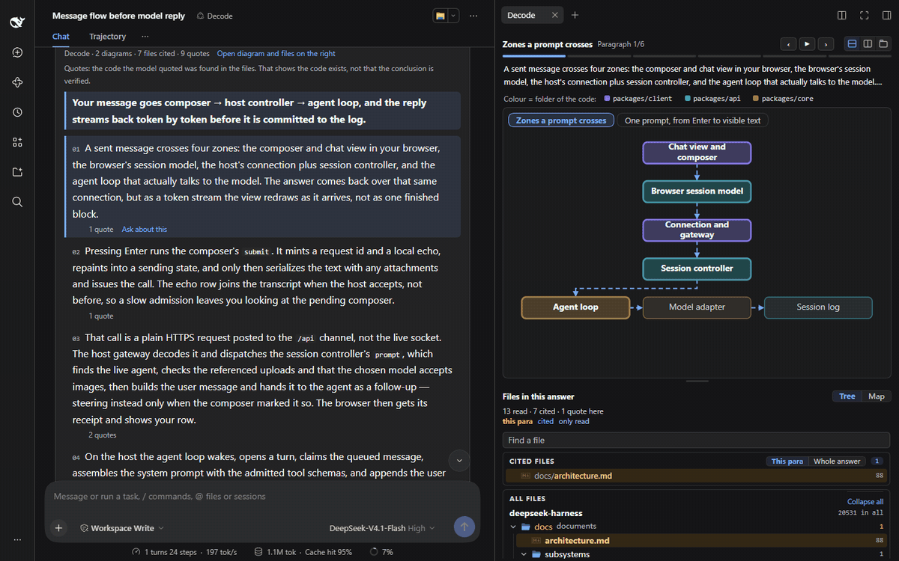
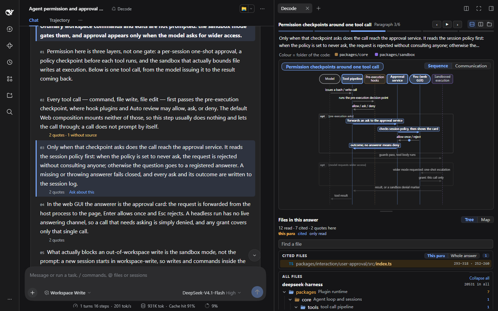
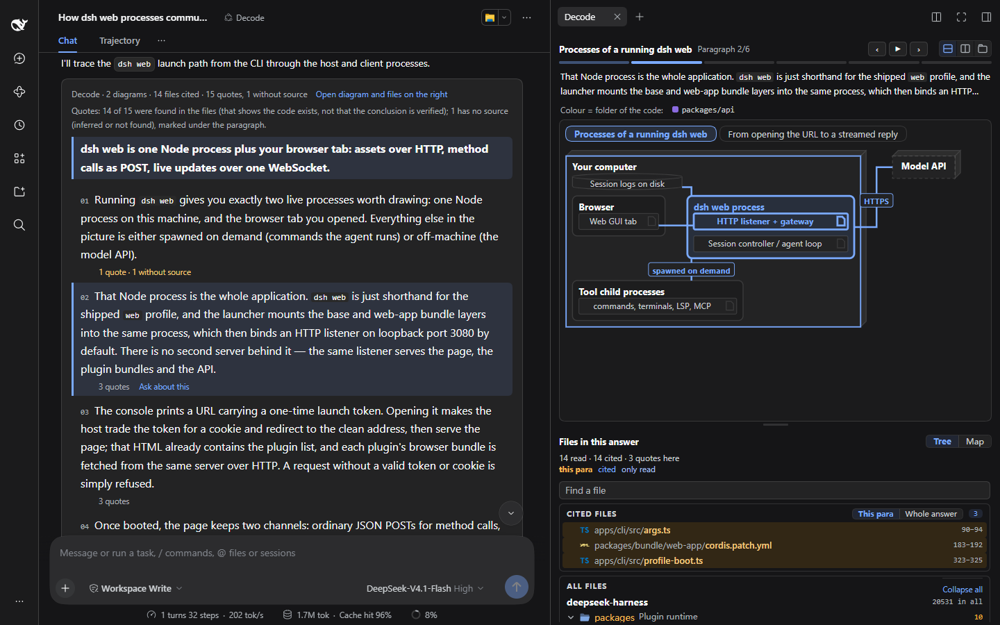
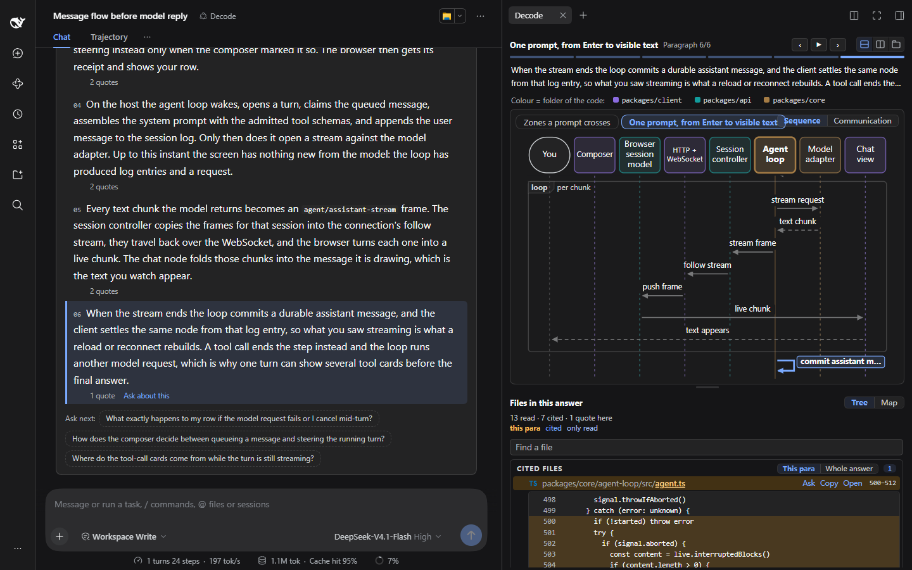

# Decode

**English** · [简体中文](README.zh.md)

## Are you a Yes Engineer?

```text
Agent     Refactor the session layer?     > yes
Agent     Change 23 files?                > yes
Agent     Delete the old retry logic?     > yes
Agent     Option A or B?                  > you pick
Agent     Tests pass. Merge?              > gogogo

Lines written: +4,117
Lines read:    0

Reviewer  Can you explain this code?      > yes
                                          > no.
```

<sub>An illustration, not a measurement.</sub>

Yes Engineer. GoGo Engineer. **Cognitive surrender, with a job title.**

> "You didn't review the code. You ratified it."
> — Addy Osmani, [Cognitive Surrender](https://addyosmani.com/blog/cognitive-surrender/)

**Decode** is a [DeepSeek Harness](https://www.npmjs.com/package/@deepseek-ai/dsh) plugin. You ask about your repository in your own words. It answers with text, a diagram, files and code, all linked, and with evidence you can check.

**Be the master of your own understanding. Learn your repository from a higher level.**

[](https://www.npmjs.com/package/dsh-decode)


[](docs/assets/decode-intro.mp4)

<sub>Click the picture to watch the 26-second video, with sound.</sub>



<sub>Above: in the deepseek-harness repository, "After a user sends a message, which parts does it pass through before the model's reply shows up on screen?". Each paragraph in turn; the diagram on the right highlights what the paragraph is about; then the cited code opens, and "Ask about this" puts the paragraph into the input box (nothing is sent).</sub>

## Install

**dsh web or the desktop app**: Plugins → Add plugin → enter `dsh-decode@preview` → Install. Then pick **Decode** in the session's mode menu.

**Command line**:

```sh
dsh plugin --profile web add dsh-decode@preview
```

Then restart dsh web. Needs dsh 0.2.1-rc.5 or a newer 0.2.x. To upgrade, remove the plugin and add it again.

## Ask your first question

```text
After a user sends a message, which parts does it pass through before the model's reply shows up on screen?
If the format of the events in the session log changes, which parts are affected?
How do the Standard, PTC, Minimal and Creator modes differ?
```

Decode is good for flows across modules, state changes, the impact of a change, how several approaches compare, processes and deployment. To look up one place in the code, the standard mode is faster.

Ask in English and the answer is in English; ask in Chinese and it is in Chinese.

## Everything is linked

| You do this | The page does this |
|---|---|
| Hover a paragraph | The diagram follows |
| Click a step in the diagram | The text goes to its paragraph |
| Change a sequence diagram to Communication | The same steps show who talks to whom |
| Point at a folder in the diagram's colour key | Its parts light up in the diagram and the map |
| Open the map | You see where the files live in your repository |
| Open a quote | You see the exact lines |
| Type in Find | The list changes on each key |
| Click **Ask about this** | The paragraph goes into your input box. Nothing is sent. |

It even warns you. This line is always at the top of the card:

> A quote found shows the code exists, not that the conclusion is verified.

## See it answer

Question: **Before the agent runs a command or changes a file, which permission checks and approvals does it go through?**



Question: **Which processes take part when you run dsh web, and how do they communicate?**



Open a quote, and you see the lines of code it rests on:



## Why yes becomes a reflex

You do not surrender when you write code, because writing keeps you in a loop of guess, fail and fix. Reading agent code has no such loop:

- **Generation effect**: you remember what you work out yourself. Now the agent works it out.
- **Prediction error**: each failure is a learning signal. With no prediction of your own, nothing fails.
- **Framing the problem**: you used to decide what to look for. Now the agent decides.
- **Fluency illusion**: agent code reads smoothly, so you think you understand it. It can pass the tests and still be wrong for the system.

Each yes makes the next one easier. Your picture of the system goes wrong in places you cannot point to, and no dashboard shows it: throughput counts approved work the same as understood work.

## What Decode does about it

Osmani's article gives the habits that stop surrender. Decode builds them into the tool:

| Habit against surrender | What Decode does |
|---|---|
| **Write down what you expect before you look** | You ask first; it does not lecture. You frame the question. |
| **Have it explain before it generates** | The mode explains. The model gets no file write or edit tools. |
| **Ask for evidence, not "looks right"** | Each paragraph quotes code, checked against the files; a quote it cannot find is marked. |
| **Do not take its authority on trust** | The warning above stays on the card. The sign-off stays yours. |
| **Correct on the surface ≠ correct for the system** | A diagram across modules follows the current paragraph; a folder tree and a map put the files back into the repository's layout. |
| **Collaborate, do not delegate** | "Ask about this" only fills the input box. The next question is yours. |

## What it does not do

- **It does not judge for you.** A quote found only means the code the model copied is in the file. It does not mean the code supports the paragraph.
- **It does not build the understanding for you.** Only you can. Decode makes it cheaper: fewer files to open, fewer call paths to guess, less time lost in the repository.
- **It does not review a diff for you.** You ask about the repository; you cannot attach a diff or an error to a question.
- **It does not guarantee that files stay unchanged.** The model has no file write or edit tools, but it has the terminal, under dsh's own permission settings. For an unknown repository, set terminal commands to ask you first ([details](docs/usage.md#tools-and-safety)). The plugin itself runs only read-only git commands and uploads nothing.

## "An AI reads it to me. Isn't that still passive?"

To be told and to be able to check are two different things. An ordinary answer asks you to trust it or not. Decode gives you where the evidence is, how the parts call each other, and a map. You can check it, find your way, and ask the next question.

## More

- [Usage details](docs/usage.md): how to read each part of an answer, time and tokens, tools and safety, the web routes, development and the code.
- [Changelog](CHANGELOG.md)
- Third-party material: [THIRD_PARTY_NOTICES.md](THIRD_PARTY_NOTICES.md) (cw-uml, vscode-icons, claude-files-pane, all MIT)

License: MIT
