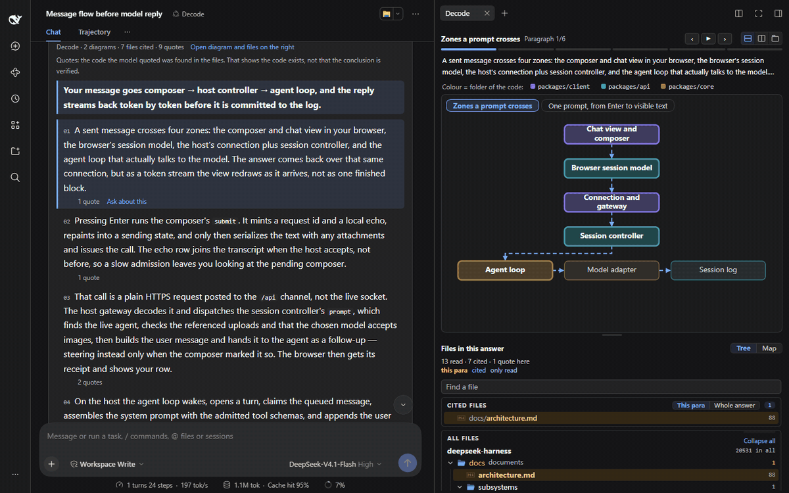
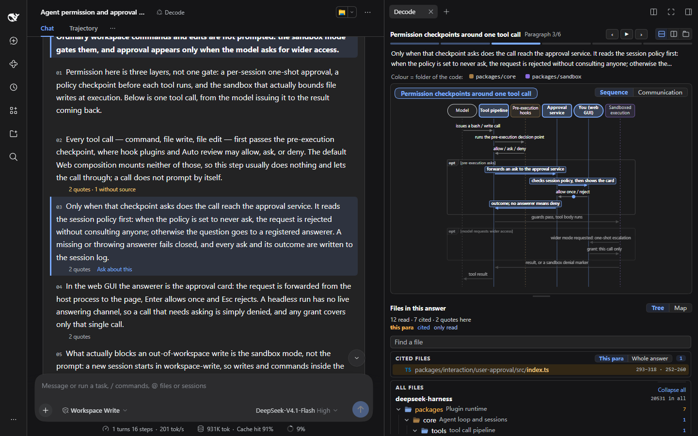
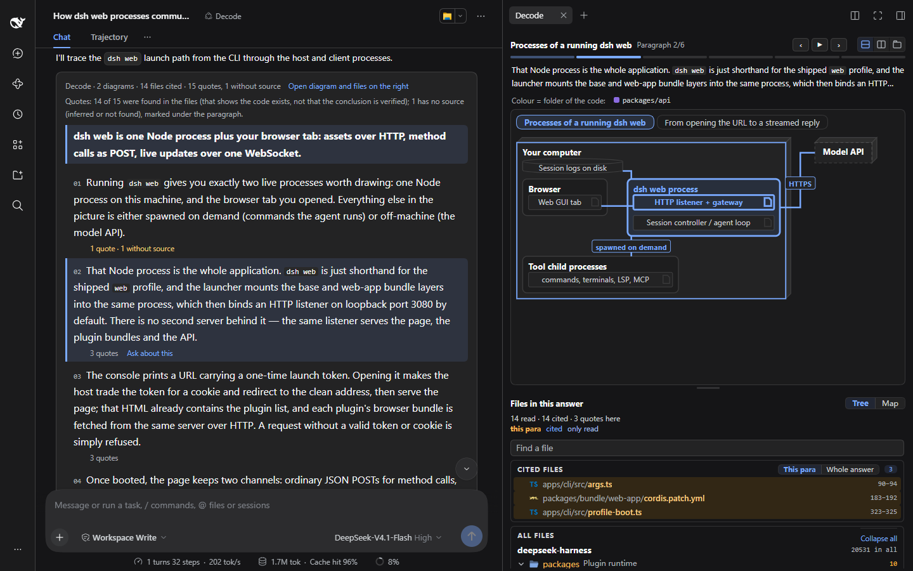
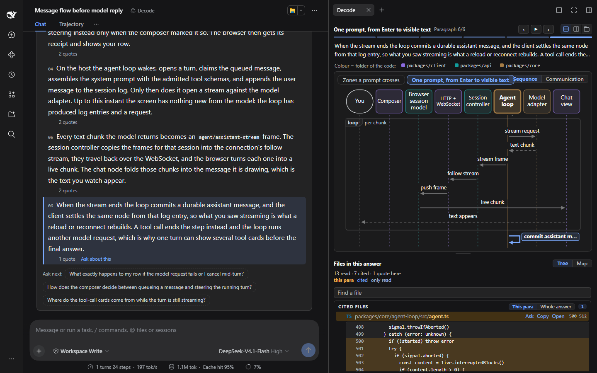

# Decode

[English](README.md) · **简体中文**

## 你是 Yes 工程师吗？

```text
Agent     要重构会话层吗？          > yes
Agent     要改 23 个文件，行吗？    > yes
Agent     旧的重试逻辑删掉？        > yes
Agent     选方案 A 还是 B？         > 你定
Agent     测试通过，合并？          > gogogo

写入行数：+4,117
读过行数：0

Reviewer  这段代码你能讲讲吗？      > yes
                                    > 不能。
```

<sub>示意场景，不是统计数据。</sub>

Yes 工程师。GoGo 工程师。**认知投降，有了职位名称。**

> “你没有评审代码，你只是追认了它。”（You didn't review the code. You ratified it.）
> —— Addy Osmani，[Cognitive Surrender（认知投降）](https://addyosmani.com/blog/cognitive-surrender/)

**Decode** 是一个 [DeepSeek Harness](https://www.npmjs.com/package/@deepseek-ai/dsh) 插件。你用自己的话问仓库的问题，它用文字、图、文件和代码回答，四者互相联动，并附上可以核对的证据。

**做自己认知的主人，从更高的层面学习自己的仓库。**

[](https://www.npmjs.com/package/dsh-decode)


[](docs/assets/decode-intro.mp4)

<sub>点击图片观看 26 秒视频（有声音）。</sub>



<sub>上图：在 deepseek-harness 仓库里问“After a user sends a message, which parts does it pass through before the model's reply shows up on screen?”（用户发出一条消息后，到模型的回复显示出来，中间经过哪些部分？）。截图用英文界面；问中文，回答就是中文。逐段切换，右侧的图跟着当前段落高亮；然后打开引用的代码，再点“追问这段”把段落填进输入框（不会发送）。</sub>

## 安装

**dsh 网页版或桌面版**：插件页 → 添加插件 → 填 `dsh-decode@preview` → 安装。然后在会话的模式菜单里选 **Decode**。

**命令行**：

```sh
dsh plugin --profile web add dsh-decode@preview
```

然后重启 dsh web。要求 dsh 0.2.1-rc.5 或更新的 0.2.x。升级时先卸载再安装。

## 问第一个问题

```text
用户发出一条消息后，到模型的回复显示出来，中间经过哪些部分？
如果修改会话日志里事件的格式，会影响到哪些部分？
标准模式、PTC 模式、极简模式、创造模式有什么区别？
```

适合问跨多个模块的流程、状态变化、改动的影响、几种做法的对照、进程和部署。只查一处代码时，用标准模式更快。

问中文答中文，问英文答英文。

## 一切都是联动的

| 你的操作 | 页面的响应 |
|---|---|
| 鼠标移到段落上 | 图跟着走 |
| 点图里的一步 | 文字跳到对应段落 |
| 把时序图切到通信图 | 同样的步骤，改为显示谁和谁通信 |
| 指向图上颜色图例里的目录 | 图和地图里相应的部分同时点亮 |
| 打开地图 | 看到文件在仓库里的位置 |
| 展开引文 | 看到确切的代码行 |
| 在查找框输入 | 列表随每次按键变化 |
| 点 **追问这段** | 段落填进输入框，不发送 |

它甚至会提醒你。卡片顶部常驻这一行：

> 引文找到只说明代码存在，不代表结论已验证。

## 看它回答

问题：**Before the agent runs a command or changes a file, which permission checks and approvals does it go through?**（智能体执行一条命令或修改文件之前，要经过哪些权限检查和审批？）



问题：**Which processes take part when you run dsh web, and how do they communicate?**（运行 dsh web 时有哪些进程参与？它们之间怎么通信？）



一处引文展开后，就是它依据的那几行代码：



## 为什么 yes 会变成条件反射

写代码时人不会投降，因为写的过程一直在“猜 → 错 → 改”的循环里。读 agent 的代码没有这个循环：

- **生成效应**：自己想出来的，记得牢。现在是 agent 在想。
- **预测误差**：每次错都是一次学习信号。人没有自己的预测，就没有“错”。
- **定义问题**：以前由你决定查什么。现在由 agent 决定。
- **流畅错觉**：agent 的代码读起来很顺，人就以为自己懂了。代码能过测试，在系统层面仍可能是错的。

每一次 yes 都让下一次更容易。你脑子里的系统模型错在了你指不出来的地方，而且没有哪个指标看得见：吞吐量不区分“理解了的工作”和“批准了的工作”。

## Decode 怎么对抗

Osmani 给了防止投降的习惯。Decode 把这些习惯做进了工具：

| 防止投降的习惯 | Decode 的做法 |
|---|---|
| **看输出之前，先写下你的预期** | 你先提问，它不主动讲。问题由你来定义。 |
| **先让它解释，再让它生成** | 这个模式只解释，模型没有写文件和编辑工具。 |
| **要证据，不要“看着对”** | 每段带引文，在文件里核对；找不到原文就标出来。 |
| **不把它的权威当真** | 上面那句提示常驻卡片。签字的资格留在你手里。 |
| **表面正确 ≠ 系统正确** | 跨模块的图跟着当前段落走；目录树和地图把用到的文件放回仓库的布局里。 |
| **协作，不要委托** | “追问这段”只填输入框。下一个问题由你来问。 |

## 它不做什么

- **不替你判断。** 引文找到，只说明模型抄的代码在文件里存在，不说明它支持这段话。
- **不替你建立理解。** 理解只能你自己建。Decode 只降低成本：少翻文件、少猜调用关系、少在仓库里迷路。
- **不替你评审 diff。** 你问的是仓库；提问时不能附带 diff 或报错。
- **不保证文件不变。** 模型没有写文件和编辑工具，但有终端（按 dsh 的权限设置）。面对陌生仓库，请把终端命令设为先询问（[详情](docs/usage.zh.md)）。插件自己只运行只读的 git 命令，不上传任何内容。

## “让 AI 读给我听，不还是被动吗？”

被告知和能核对是两回事。普通的回答让你选择相信或不信。Decode 给你证据的位置、调用关系和地图，你可以自己验证、自己导航、继续追问。

## 更多

- [使用细节](docs/usage.zh.md)：回答的每个部分怎么读、时间和 token、工具与安全、网页接口、开发和代码结构。
- [更新记录](CHANGELOG.md)
- 第三方材料：[THIRD_PARTY_NOTICES.md](THIRD_PARTY_NOTICES.md)（cw-uml、vscode-icons、claude-files-pane，均为 MIT）

许可证：MIT
